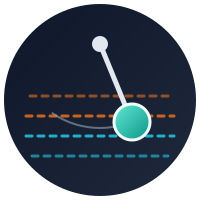

# Pendulum

**Async grid trading bot for the crypto spot market — backtest, paper-trade, then trade sideways ranges.**

Pulls market data from Bybit (V5 REST + WebSocket; more exchanges via pluggable adapters), evaluates grid
strategies net of maker/taker fees, slippage and unrealized inventory loss, and benchmarks them against buy & hold
with walk-forward validation. Results land in PostgreSQL; alerts and reports go to Telegram.

> ⚠️ Pendulum is research software. All backtest and paper-trading results are historical simulations, not a
> forecast or a guarantee of profit.

## Features

Planned for Stage 1 (read-only): historical candle loader, arithmetic/geometric grid engine with exchange filters,
conservative fill simulator, backtester with honest metrics, walk-forward parameter search, pair scanner,
paper trader on live WebSocket data, Telegram notifications.

## Quick start

_Available after Stage 1._ Copy `.env.example` to `.env`, then `docker compose -f docker-compose.local.yml up -d`.

## Architecture

_Documented during Stage 1._ Core idea: one grid engine runs on three interchangeable executors — simulator
(backtest), paper trading and live exchange — selected by swapping the `IOrderGateway` implementation. Exchanges
plug in via `BaseExchangeAdapter` and an exchange registry.

## Configuration

All settings come from environment variables grouped into Pydantic settings classes; see `.env.example`.

## Roadmap

- **Stage 1** — MVP + data: backtest, walk-forward, pair scanner, paper trading, Go/No-Go report (`v0.1.0`).
- **Stage 2** — Production on VPS with CI/CD, live execution, risk manager and kill-switch (`v0.2.0`).
- **Stage 3** — Multi-pair/multi-exchange, pair rotation, admin dashboard with analytics (`v0.3.0`).
